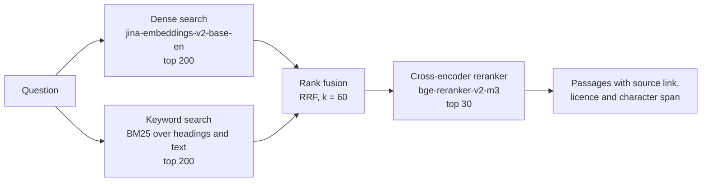

# rag-core

**A retrieval library that finds the right passage in technical documentation and shows exactly where it came from.** It was built and measured on its own, then wired into the [Aethelgard Academy](https://github.com/AsheeshSrivastava/aethelgard-academy) learning platform, where its tutor (AXIS) uses it as an optional search mode.

[Try the live demo](https://huggingface.co/spaces/asheeshsrivastava9/rag-core-portfolio) · [Decisions (ADRs)](docs/adr/README.md) · [Specs](docs/specs/README.md) · [Full comparison report](docs/reports/retrieval-comparison-report.md)

| | |
|---|---|
| **Role** | Product architect and owner: I defined the problem, made and recorded every design decision, wrote the test questions and judged the results. The implementation was done with AI coding assistants under my direction, and each decision is in an ADR so it can be checked. |
| **Status** | v0.2.0, installable, Apache-2.0. Used by the Aethelgard Academy LMS as an optional hybrid-search mode (merged 2026-11-19). The LMS still starts in keyword-only mode by default. |
| **Tests** | 1,247 automated tests pass (5 skipped, 39 deselected by default), checked on 2026-11-19 with `uv run pytest -q`. |

---

## The problem

The Aethelgard tutor must answer from real documentation, and a learner must be able to see the source of what they are told.

When search and answer writing are built as one piece, a wrong answer cannot be traced to its cause: it could be a bad search, bad context, or the model making things up. So retrieval was built, measured and tested alone first, before any answer writing. This library never calls a text-generating model.

## Who it is for

- **The tutor inside the LMS.** It needs passages it can cite, each with a source link, licence and exact position in the source.
- **The product owner.** Choosing models and settings needs measured evidence, not opinion.

## Product decisions

| Decision | Why | Evidence |
|---|---|---|
| Retrieval only. No answer writing here. | A failure can be traced to search, not to generation. | No code in this library calls a text-generating model. |
| Nothing is indexed until its source is approved and passes a licence check. | Learners see only content we may legally show. | 30 sources, each with a recorded licence in the index. |
| Compare options with a rule written before the results. | Stops me picking the winner after seeing the numbers. | 14 setups compared on 548 questions ([spec 13, section 5](docs/specs/13-embedder-chunker-comparison.md)). |
| Local models, not a paid cloud reranker. | Cost and independence. | [ADR 0009](docs/adr/0009-hybrid-search-and-local-reranker.md) records the paid option as too expensive. |
| Final pick: `jina-embeddings-v2-base-en`, the LlamaIndex chunker, hybrid search and a reranker. | Best result on the passage-level question set. | [ADR 0010](docs/adr/0010-final-chunker-and-embedder.md) and the results below. |
| Every passage is an exact slice of its approved source. | A citation must point at text that really exists. | The index build stops with an error if a passage is not an exact slice ([ADR 0003](docs/adr/0003-contracts-canonical-text-and-ids.md)). |

## Results

Each number says what it counts.

- **Choosing the setup (548 questions).** The winning setup put the right file first on 334 of 548 questions. Late chunking (embedding the whole file at once) lost everywhere, for example 62 against 310 right-first on one setup.
- **Final check (137 passage-level questions).** For the chosen embedder, vector-only search put the right passage first on 64 of 137 questions and in the top 3 on 85. Hybrid search plus the reranker put it first on 100 and in the top 3 on 121.
- **In the LMS (240 learner-style questions, measured 2026-11-19).** Against the LMS's own 1,371 documentation files, the right file was in the top 3 results for 75.0% of questions with hybrid search, against 57.1% for the LMS's earlier keyword search. For questions put in different words from the documentation, it was 66.7% against 30.0%. Going through the LMS adapter gave exactly the same numbers as running rag-core directly. The LMS corpus is a different, smaller corpus than this repository's index, so these numbers are not comparable with the two lines above.
- **Index.** 26,614 passages from 30 sources, under 6 licence types.

## How it fits the LMS

rag-core sits behind a small interface in the LMS, so the tutor does not depend on rag-core's internals ([ADR-0035](https://github.com/AsheeshSrivastava/aethelgard-academy/blob/main/docs/adr/0035-axis-retrieval-strategy.md)).

- **Optional, and off by default.** Hybrid mode is switched on with a setting. The tutor otherwise runs keyword-only, which needs no models or GPU.
- **A failure is never quiet.** If the models, the index or the time budget fail, the tutor answers from keyword search and shows "Keyword search only" next to the answer.
- **A "not in the course" rule.** The tutor declines to answer from the course when the best passage is too weak. On the test questions this wrongly declined 6.2% of good questions and correctly declined 41.7% of out-of-scope ones, a little under the 43.3% aimed for. I accepted that and wrote down why.
- **Speed.** About 150 ms per search on a local GPU (median over 300 searches, slowest 211 ms).

## Honest limits

- The 137-question set is not blind. I chose the passages and wrote the questions myself; two outside reviewers checked them.
- Chunk size and the late-chunking window were each tried at one setting, so there was no sweep.
- The live demo runs on Hugging Face ZeroGPU. Timing on plain CPU was not measured.
- The demo does not repeat the exact-slice check at query time. That check was enforced when the index was built.
- Search quality for questions in different words from the documentation is better but still the weakest area (66.7% in the top 3 in the LMS).
- The corpus snapshots and the built index are not stored in this repository (their licences are the documentation authors' own).

## What I will revisit after real use

An optional step to add a short model-written "where this passage sits" sentence to each passage, for search only, was designed and then **deliberately skipped** (2026-11-19). A cheaper keyword-only variant gave only a small gain, and hybrid search alone lifted paraphrased questions from 30.0% to 66.7%. I will look at it again after the tutor has been used by real learners, and only if the questions it still misses justify the cost.

---

## Try it

Ask a technical question in the [live demo](https://huggingface.co/spaces/asheeshsrivastava9/rag-core-portfolio) and you get the passages with their source, licence and character span. Examples taken from the frozen 137-question set:

- *How is a product listing treated if it names a high-end label, is cheap, and claims to be the real thing?* (traces to the Anthropic Cookbook content-moderation example)
- *In the example of generating code from comments, which statement was missing from the model's output?* (traces to the DAIR.AI Prompt Engineering Guide)

## Use it as a library

```bash
pip install "ragcore[embed,variants] @ git+https://github.com/AsheeshSrivastava/Content-Library-Aethelgard-Academy@v0.2.0"
```

```python
from ragcore import Retriever, load_models

embedder, reranker, setup = load_models()  # pinned models; the index must have been built with the same setup
with Retriever.open("index.db", setup, embedder=embedder, reranker=reranker) as retriever:
    for hit in retriever.search("How do I mark a pytest test as slow?", k=3, max_per_file=1):
        print(hit.rank, hit.source_id, hit.licence, hit.url, hit.start, hit.end)
```

- The index is one SQLite file that records how it was built and refuses to open with a different setup.
- Plain `pip install ragcore` (core dependencies only: PyYAML and NumPy) is enough for the keyword-only variant (`variant="L"`); the `embed` extra adds torch and transformers.
- The public surface is exactly `Retriever`, `Result`, `IndexSetup`, `open_index`, `IndexStoreError`, `load_models` and `__version__` ([spec 18](docs/specs/18-packaging.md)).
- Building an index from your own approved sources is described in [spec 17](docs/specs/17-indexer-and-retriever.md).

## How it works



1. **Hybrid retrieval.** Two lists are merged by reciprocal rank fusion, so exact words and similar meaning both count, and the top 30 are reordered by a cross-encoder reranker.
2. **Exact-slice passages.** Every passage is `source.text[start:end]` of an approved, pinned source version. The index build fails if that does not hold.
3. **Repeatable ranking.** Ties are broken by row position, so equal scores always come back in the same order.
4. **Licence gate.** A source is registered, its licence is detected and cross-checked, a human approves it, and it is fetched pinned to an exact commit before anything is indexed.

More detail: [problem statement](docs/architecture/01-problem-statement.md), [system design](docs/architecture/02-system-design.md), [comparison report](docs/reports/retrieval-comparison-report.md).

## Repository map

| Path | What is there |
|---|---|
| `src/ragcore/` | The library: contracts, loaders, chunkers, embedders, fusion, reranker, index store and retriever |
| `docs/adr/` | Decision records (why each choice was made) |
| `docs/specs/` | One spec per unit, written before the code |
| `eval/` | The question sets (548 file-level, 137 passage-level, and out-of-scope questions) |
| `tests/` | The automated tests |
| `scripts/` | Index, comparison and evaluation commands |

Working rules for contributors and AI assistants are in [AGENTS.md](AGENTS.md); `PROGRESS.md` records the current status.

## Indexed corpus and licences

The index behind the demo holds 26,614 passages from 30 approved sources (2,156 files). By licence: MIT 11,303, Apache-2.0 8,979, PSF-2.0 3,190, CC-BY-SA-4.0 2,389, CC-BY-4.0 680, CC0-1.0 73. Every retrieved passage carries its upstream source link and licence so attribution travels with the text. The full source list with licences and passage counts is in the demo's README: [Hugging Face Space](https://huggingface.co/spaces/asheeshsrivastava9/rag-core-portfolio).

## Licence and thanks

The code is Apache-2.0 ([LICENSE](LICENSE)). The indexed documentation remains the property of its authors under the licences above.

Built on open-source work: [jina-embeddings-v2-base-en](https://huggingface.co/jinaai/jina-embeddings-v2-base-en) by Jina AI (Apache-2.0), [bge-reranker-v2-m3](https://huggingface.co/BAAI/bge-reranker-v2-m3) by BAAI (MIT), [LlamaIndex](https://github.com/run-llama/llama_index) for chunk boundaries (MIT), [Hugging Face Transformers](https://github.com/huggingface/transformers) and [PyTorch](https://github.com/pytorch/pytorch).

## Author

Asheesh Ranjan Srivastava · [GitHub](https://github.com/AsheeshSrivastava) · [LinkedIn](https://linkedin.com/in/asheesh-ranjan-srivastava)
