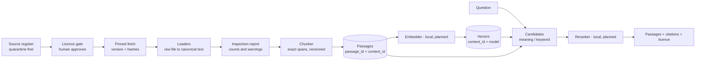

# System design (draft, rag-core)

Status: Proposed. Items marked *planned* are not built.

## Data flow

## Layers and rules

1. **Register and gate.** Specified in [spec 02](../specs/02-register-and-gate.md) (ADR 0005, 0006). The record type is `SourceRecord`. A source starts in quarantine and moves only to approved, limited, reference-only or rejected. Rules set the highest status a licence can earn; a human approves. Carried from library3.
2. **Pinned fetch.** Specified in [spec 03](../specs/03-pinned-fetch.md). Exact git commit or hashed web page; licence file hashed; licence text change sends the source back to quarantine; host allow-list; symlinks dropped; size limits. Merge of the library3 fetcher and the production-rag GitHub loader (owner approved 2026-10-28).
3. **Loaders.** Specs follow per loader (see docs/specs). One loader per format. The loader output is the canonical text. Every Source records `raw_sha256` (input file), `text_sha256` (canonical text), `loader_version`, `normalizer_version`, licence and where it came from.
4. **Normalize once** ([spec 01](../specs/01-contracts.md)). BOM removed, Unicode NFC, `\n` line endings, applied when the Source text is made. Everything downstream uses that text.
5. **Inspection.** A script prints, per source: files seen, indexed, skipped by reason; pieces over the cap or very small; leftover markup; directive-only stubs; front matter left in; notebook outputs; duplicates (exact and near). It fails the run when too many files are skipped.
6. **Chunker.** A pure function from canonical text to spans. Baseline is structure-first (headings, never inside code fences or tables). Versioned; the version is stored and is part of `passage_id`. Parent-child and a LlamaIndex variant are compared on cleaned text before anything is adopted.
7. **Passages and IDs.**
   - Exact slice: `passage.text == source_text[start:end]`, checked on read-back in tests and in the inspection script.
   - `passage_id` = hash(source_id, version, start, end, text_hash, chunker_version). Positional; used in citations; changes when chunking changes.
   - `content_id` = text hash. Identifies the text itself. Vectors are stored under (`content_id`, model), so a re-chunk or re-index only embeds text not seen before.
8. **Store.** SQLite behind one interface so a vector database can replace it. Chunks and vectors in separate tables. The store records which model built each vector and refuses to search with another.
9. **Search.** Meaning candidates, optional keyword candidates (hybrid), then rerank. Methods stay switchable so each is judged on the same questions. Lookup bands are re-set for the final setup.
10. **Evaluation.** Question sets point at `(source_id, file/heading, quote)`. Reports show first-hit and top-3 counts, failed calls, and "no passage helps" replies apart from errors.

## Loader plan

| Loader | Source | Status |
|---|---|---|
| Inspection script | new | first |
| GitHub at a pinned commit | merge of library3 fetch and production-rag github loader | planned |
| Markdown / MDX / front matter | library3 splitter + new cleaning | planned |
| reStructuredText | library3 | planned |
| HTML (local and web) | production-rag `html_extract`; arXiv rules as a profile | planned |
| Jupyter notebook | new; markdown cells, code cells fenced, outputs dropped by default, cell index kept | planned |
| Plain text | both | planned |
| PDF, CSV, JSON, Python source | production-rag has PDF/CSV; others later | not now |

## Boundaries
- Loaders know files and repos; they do not know the store, models or chunking.
- Contracts depend on nothing else. Chunkers depend only on contracts.
- Anything that calls a model or network sits behind an interface so tests run offline.
